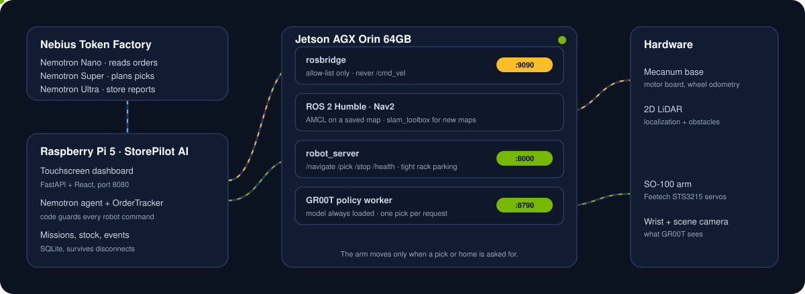

<p align="center">
  
</p>

<p align="center">
  
  
  
  
  
  
</p>

<p align="center">
  <b>An AI dark-store order picker.</b> Type an order in plain words. Nemotron plans it,<br>
  the robot drives to the rack with Nav2, and a GR00T policy on an SO-100 arm puts each item in the basket.
</p>

<p align="center">
  Built for the <b>Nebius × NVIDIA Global AI Hackathon</b>, Physical AI track.
</p>

> [!NOTE]
> Runs on the real robot: navigation, the dashboard, the Nemotron planner and **GR00T pick and place
> on the SO-100 arm**. On a fresh install the arm stays still until you set
> `STOREPILOT_MANIPULATION_VERIFIED=1`, so it never moves before someone has checked it.

---

## ✨ From a typed order to a packed basket

<p align="center">
  
</p>

1. **Order.** A customer types something like *"2 ink boxes and a biscuit"* on the StorePilot dashboard.
2. **Read.** Nemotron Nano turns the text into product ids and quantities from the catalog.
3. **Plan.** Nemotron Super plans the route by rack and calls the robot's tools, one at a time. It only
   chooses product ids; the code checks every command before the robot gets it.
4. **Drive.** Nav2 drives the mecanum base to the rack with AMCL and a 2D LiDAR, and parks within a
   few centimetres of the spot where the arm's demonstrations were recorded.
5. **Pick.** One GR00T N1.7 episode per unit: from the rest pose, pick, place in the basket, back to rest.
   Several units on the same rack are picked without driving in between.
6. **Report.** The code builds the bill from what is really in the basket. Nemotron Ultra writes the
   shift report and the store analysis.

## 🧭 How it fits together

<p align="center">
  
</p>

| Where | What runs there |
|---|---|
| **Nebius Token Factory** | Nemotron Nano, Super and Ultra behind an OpenAI-compatible API |
| **Raspberry Pi 5** | StorePilot AI: touchscreen dashboard (FastAPI + React), the Nemotron agent and its guards, mission history |
| **Jetson AGX Orin 64GB** | ROS 2 Humble with Nav2, rosbridge for the dashboard, the robot API server, and the GR00T policy worker that keeps the model loaded |
| **Robot** | Mecanum base with motor board, 2D LiDAR, SO-100 arm (Feetech STS3215), wrist and scene cameras |

## 🛡️ Safety by design

The model plans; the **code** decides what reaches the robot.

- Only product ids from the catalog are sent to `/pick`: no empty ids, no free text, no unknown products.
- No picking at the wrong rack, no more units than ordered, no driving while a pick runs.
- A failed pick is retried by the code (`PICK_RETRIES`, default 2), then reported as *not picked*; the order goes on.
- If the gripper still holds something after a pick, everything stops until a person checks the arm.
- **STOP** cancels the Nav2 goal and halts the arm where it is.
- rosbridge only exposes an allow-list of topics: the dashboard can never publish raw `/cmd_vel`.
- Motion and picking are separate switches (`STOREPILOT_ENABLE_MOTION`, `STOREPILOT_MANIPULATION_VERIFIED`), off by default.

## 🧠 NVIDIA and Nebius

| Component | Used for |
|---|---|
| **NVIDIA GR00T N1.7** (via LeRobot) | Vision-language-action policy for the arm, running on the Jetson |
| **NVIDIA Nemotron** (Nano · Super · Ultra) | Reading orders, planning the picks, store reports |
| **NVIDIA Cosmos** | Augmenting real demonstrations with lighting and background variations |
| **NVIDIA Jetson AGX Orin 64GB** | All on-robot compute |
| **Nebius AI Cloud** | GR00T fine-tuning |
| **Nebius Token Factory** | Serving Nemotron |

### Policy pipeline

```
teleoperated demos (SO-100 leader → follower, LeRobot)  →  Cosmos augmentation
        →  GR00T fine-tuning  →  policy worker on the same Jetson
```

No simulation: all training data comes from the real robot.

## 🏪 The store today

One rack (Nav2 station `shelf_A`) with two shelf levels. The robot parks at the rack; the shelf level only
tells GR00T where to reach.

| Product | Level |
|---|---|
| Ink Box · Fevicol · Screen Cleaning Gel | `upper_shelf` |
| Biscuit · Frooti | `lower_shelf` |

Products live in [`agent/store_agent/catalog.json`](agent/store_agent/catalog.json); the GR00T instruction per
product is in `policy/instructions.json` (one per robot, not in Git).

## 🚀 Quick start

**Try the dashboard on a laptop** (built-in simulated robot, nothing moves):

```bash
cd storepilot
./run_local.sh setup     # once: venv, frontend build, .env
./run_local.sh           # http://localhost:8080
```

Or with Docker, from the repo root:

```bash
docker build -f storepilot/Dockerfile -t storepilot-demo .
docker run -p 8080:8080 -e NEBIUS_API_KEY=... storepilot-demo
```

Without `NEBIUS_API_KEY` the dashboard uses an offline order parser and autopilot instead of Nemotron.

**On the robot (Jetson):**

```bash
cd ros2_ws
docker compose build                                                        # once
docker compose run --rm ros ros2 launch mecanum_nav navigation.launch.py map:=<map>
docker compose up -d robot_server                                           # robot API on :8000
cd ../policy && inference/jetson/pick_worker.sh --model <run>_060000        # GR00T policy worker
```

Step-by-step guides are in each folder's README (below).

## 🗂️ Repository layout

```
agent/        Nemotron agent (order parsing, planner, guards) and the robot API server (runs on the Jetson)
storepilot/   StorePilot AI dashboard: backend/ (FastAPI) and frontend/ (React), deploy scripts
policy/       LeRobot project: recording demonstrations, GR00T training and the policy worker (owns arm and cameras)
ros2_ws/      ROS 2 workspace: mecanum base, LiDAR, SLAM, Nav2
docs/         Architecture notes, tool feedback and the images in this README
```

## 📚 Docs

| Topic | Guide |
|---|---|
| Dashboard: setup, live mode, safety switches | [storepilot/README.md](storepilot/README.md) |
| Agent and tests | [agent/README.md](agent/README.md) |
| Robot API, parking, the arm | [agent/robot_server/README.md](agent/robot_server/README.md) |
| Recording, training, the policy | [policy/README.md](policy/README.md) |
| Running a model on the arm, the policy worker | [policy/docs/INFERENCE.md](policy/docs/INFERENCE.md) |
| Base, LiDAR, maps and Nav2 | [ros2_ws/README.md](ros2_ws/README.md) |

## ⚙️ Setup

Copy `.env.example` to `.env` and fill in your own credentials. Never commit `.env`.

## 📄 License

Apache 2.0. See [LICENSE](LICENSE).
